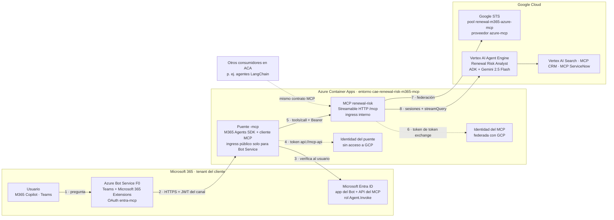
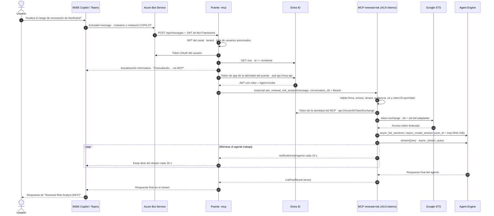

# Renewal Risk Analyst (MCP) — M365 Copilot → MCP en ACA → agente de GCP

Segunda versión de la integración de **Microsoft 365 Copilot** con el *Renewal Risk
Analyst* de **Google Cloud Vertex AI Agent Engine**. A diferencia de la
[versión directa](../m365-copilot-gcp-agent/README.md), el puente **no habla con
Agent Engine**: invoca al agente a través de un **servidor MCP** desplegado en Azure
Container Apps. Las dos versiones conviven y se pueden enseñar a la vez.

> **Principio:** el agente de GCP no se copia ni se reimplementa. El MCP es un
> adaptador del tipo *agente como herramienta*: cada llamada a la herramienta se
> convierte en una consulta al Agent Engine desplegado, que conserva su modelo,
> sus herramientas y su historial.

**Estado:** desplegado y **validado de extremo a extremo desde M365 Copilot**.
Una pregunta sobre Contoso hecha en Copilot recorrió puente → MCP → Agent Engine, y el
agente respondió con el análisis completo en 30 s.

---

## 1. Por qué MCP en ACA

Escenario objetivo: la plataforma del cliente vive en Azure (agentes LangChain en
ACA, puente de M365 Copilot) y consume agentes que residen en otras nubes. El
MCP de cada agente se coloca **en ACA**, como capa de integración de la plataforma:

| Decisión | Motivo |
|---|---|
| **Un MCP por agente remoto** | Cada adaptador tiene su propia identidad y **solo esa identidad** tiene permiso sobre su agente en la nube de destino. Despliegues y fallos independientes. |
| **Autenticación Entra hacia el MCP** | Un único proveedor de identidad para todos los consumidores (puente, agentes LangChain). El MCP exige un token de app con el rol `Agent.Invoke`. |
| **El puente no tiene acceso a GCP** | Solo puede llamar al MCP. La confianza con GCP se limita al adaptador. |
| **Ingress interno** | El MCP solo es accesible dentro de su entorno ACA; no se publica en Internet. |
| **Herramientas sin estado con progreso** | `ask_renewal_risk_analyst` y `reset_conversation`, Streamable HTTP sin estado y notificaciones de progreso cada 15 s. |
| **APIM** | Para más adelante, como gateway MCP central (autenticación, límites, logs y catálogo). |

Agent Engine **no expone MCP**: su API es REST (`:query` y `:streamQuery`), y los
servidores MCP gestionados por Google Cloud no incluyen la invocación de agentes.
Por eso hace falta este adaptador.

---

## 2. Arquitectura



---

## 3. Flujo detallado



Notas:

- El MCP separa las sesiones por **consumidor**: `user_id = "mcp:" + SHA-256(client ID
  del llamante, conversation_id)`. El puente y otros agentes nunca comparten sesión,
  ni tampoco con la versión directa, que usa otras claves.
- Los errores del agente se devuelven como error de herramienta con una referencia;
  los detalles internos solo quedan en los logs del MCP.

---

## 4. Contrato MCP

| Herramienta | Entrada | Salida |
|---|---|---|
| `ask_renewal_risk_analyst` | `message` (1–16000 caracteres), `conversation_id` (1–256 caracteres opacos) | Texto final del agente. Progreso cada 15 s. Puede tardar entre 20 s y 3 min |
| `reset_conversation` | `conversation_id` | Borra la sesión remota de ese consumidor y esa conversación |

- Endpoint: `https://ca-renewal-risk-mcp-server.internal.<dominio>/mcp`. Transporte
  Streamable HTTP sin estado (MCP SDK 2.3).
- Autenticación: `Authorization: Bearer <token Entra>`, con audiencia `api://<mcp-api-app-id>`
  y `roles` que contenga `Agent.Invoke`. La API exige asignación previa del rol, y además
  el MCP restringe los client IDs permitidos.
- Sin token: **401** con `WWW-Authenticate: Bearer`.

**Añadir otro consumidor**, por ejemplo un agente LangChain en ACA:

1. Asignar a su identidad administrada el app role `Agent.Invoke` de la API
   *Renewal Risk MCP - GCP agent*, por Graph `appRoleAssignments`.
2. Añadir su client ID a `allowedClientIds` del MCP y volver a desplegar.
3. Desplegarlo en el mismo entorno y usar la URL interna con un token para `api://<mcp-api-app-id>`.

---

## 5. Guía de despliegue

Requisitos y fases comunes, como Bot, canales y paquete M365, en la
[guía de la versión directa](../m365-copilot-gcp-agent/README.md#4-guía-paso-a-paso-para-el-cliente).
Lo específico de esta versión. Antes, copiar [.env.example](.env.example) a `.env`
(excluido de git) y rellenar suscripción, tenant, usuarios autorizados, ACR y el recurso
de GCP; los scripts lo leen al arrancar. En los comandos, `<sub>`, `<tenant>` y `<acr>`
son esos mismos valores.

```powershell
# 1. Base aislada: entorno ACA y dos identidades; AcrPull en el ACR existente
az deployment group create -g rg-renewal-risk-m365-aca --subscription <sub> `
  --template-file .\infra\foundation-mcp.bicep --parameters registryName=<acr> `
  --query properties.outputs -o json > .\data\foundation-mcp.json

# 2. Imágenes, en repositorios propios
az acr build -r <acr> --image renewal-risk-mcp-server:<tag> --no-logs .\mcp-server
az acr build -r <acr> --image renewal-risk-m365-mcp:<tag>  --no-logs .\bridge

# 3. Federación GCP SOLO para la identidad del MCP (pool y proveedor nuevos)
.\.venv\Scripts\python.exe .\scripts\deploy_federation_mcp.py --apply `
  --principal <mcpPrincipalId> --issuer https://login.microsoftonline.com/<tenant>/v2.0 `
  --audience fb60f99c-7a34-4190-8149-302f77469936

# 4. Entra + Bot + las dos Container Apps + endpoint del Bot
.\.venv\Scripts\python.exe .\scripts\deploy_mcp_stack.py --apply `
  --mcp-image <acr>/renewal-risk-mcp-server@sha256:<d> --bridge-image <acr>/renewal-risk-m365-mcp@sha256:<d>
```

[deploy_mcp_stack.py](scripts/deploy_mcp_stack.py):

- **Primera ejecución, o con `--entra`:** abre un inicio de sesión interactivo en Entra
  con MSAL. Crea la API del MCP con el rol `Agent.Invoke` y asignación obligatoria,
  asigna el rol a la identidad del puente, y crea el registro del Bot y su secreto.
  El secreto se rota (borra los anteriores emitidos por el script) y solo vive en
  memoria, en ACA y en la conexión OAuth.
- **En todas las ejecuciones:** crea o actualiza el Bot (F0, Teams + Microsoft 365
  Extensions, OAuth), despliega [mcp-server.bicep](infra/mcp-server.bicep) y
  [bridge.bicep](infra/bridge.bicep), y configura el endpoint del Bot.
- **Actualizaciones de imagen:** sin `--entra`, reutiliza el secreto guardado en ACA.

Paquete M365: `bridge\scripts\build_package.py`. Genera
`bridge\dist\renewal-risk-agent-mcp.zip`, con app **Renewal Risk Analyst (MCP)**,
su propio ID e icono morado. Publicarlo en el catálogo de la organización como la versión directa.

---

## 6. Demostración: seguir la petición de extremo a extremo

**0. Antes de la demo, calentar las herramientas del agente.** Los servidores MCP de CRM
y ServiceNow que usa el agente de GCP, y los simuladores que hay detrás, escalan a
cero. Si el agente se ejecuta con ellos en frío, falla con
`Tool 'list_accounts' not found` o con `simulator_unreachable`. Afecta igual a las dos
versiones. Ejecutar unos minutos antes; solo hace llamadas de lectura:

```powershell
.\.venv\Scripts\python.exe .\scripts\warmup_agent_tools.py
# CRM (Salesforce): OK in 0.5s (attempt 1)
# ServiceNow: OK in 14.3s (attempt 1)
```

Vuelven a apagarse tras un rato sin uso. Si una respuesta del agente dice que no pudo
recuperar cuentas o incidencias, repetir el calentamiento y la pregunta en un chat nuevo.

**1. Puente `-mcp`**, para comprobar que la petición llega desde Copilot:

```powershell
az containerapp logs show -n ca-renewal-risk-m365-mcp -g rg-renewal-risk-m365-aca --subscription <sub> `
  --type console --tail 300 --format text | Select-String "Invoking MCP agent|MCP progress|MCP answered"
```

Salida real de la pregunta hecha en Copilot:

```text
INFO:__main__:Invoking MCP agent: channel=msteams:COPILOT key=4e5540bcac41 streaming=True
INFO:mcp_engine:MCP progress key=4e5540bcac41 15.0s: El Renewal Risk Analyst sigue trabajando en GCP
INFO:__main__:MCP answered key=4e5540bcac41 in 30.0s (4053 chars)
```

**2. MCP**, para ver quién llama, la sesión y el tiempo:

```powershell
az containerapp logs show -n ca-renewal-risk-mcp-server -g rg-renewal-risk-m365-aca --subscription <sub> `
  --type console --tail 300 --format text | Select-String "tools/call|Agent Engine session"
```

Salida real de esa misma petición:

```text
INFO:renewal_risk_mcp:tools/call ask caller=<bridge-client-id> key=9e9ee79f568f
INFO:agent_engine:Agent Engine session=<session-id> key=mcp:9e9ee79f (created)
INFO:renewal_risk_mcp:tools/call ask key=9e9ee79f568f answered in 29.9s (4053 chars)
```

`caller` es el client ID de la identidad del puente (`id-renewal-risk-m365-mcp`):
el MCP sabe qué consumidor llama, autenticado por Entra.

**3. GCP**, con la conversación vista por el agente, reutilizando
[show_gcp_trace.py](scripts/show_gcp_trace.py) con ADC:

```powershell
.\.venv\Scripts\python.exe .\scripts\show_gcp_trace.py --key mcp:9e9ee79f
```

Muestra el mensaje recibido, las herramientas del agente (CRM, uso, contratos) y su
respuesta. La sección 5 de la [versión directa](../m365-copilot-gcp-agent/README.md#5-demostración-ver-en-gcp-cómo-llegó-la-petición-y-qué-respondió)
explica la consola de GCP y los logs de auditoría. Aquí `principalSubject` es la
identidad del **MCP**, no la del puente.

---

## 7. Comparativa con la versión directa

| | Versión directa | Versión MCP |
|---|---|---|
| Puente → agente | REST de Agent Engine | MCP (`tools/call`) |
| Quién tiene acceso a GCP | El puente | Solo el adaptador MCP |
| Reutilización | Solo el puente | Cualquier consumidor MCP del entorno, por ejemplo LangChain |
| Autorización por consumidor | — | Rol Entra `Agent.Invoke` + client IDs permitidos |
| Saltos | Copilot → puente → GCP | Copilot → puente → MCP → GCP; un salto interno, de milisegundos frente a 20–150 s del agente |
| Añadir otro agente u otra nube | Cambiar el puente | Otro adaptador MCP con su identidad y su federación |

---

## 8. Recursos `-mcp`

Los identificadores concretos del entorno están en `.env` (ver [.env.example](.env.example))
y en el estado local `data/deploy-mcp.json`, ambos excluidos de git.

| Recurso | Valor |
|---|---|
| Entorno ACA | `cae-renewal-risk-m365-mcp` (`<dominio-del-entorno>.eastus.azurecontainerapps.io`) |
| MCP | `ca-renewal-risk-mcp-server` (interno): `https://ca-renewal-risk-mcp-server.internal.<dominio-del-entorno>.eastus.azurecontainerapps.io/mcp` |
| Puente | `ca-renewal-risk-m365-mcp`: `https://ca-renewal-risk-m365-mcp.<dominio-del-entorno>.eastus.azurecontainerapps.io` |
| Identidades | `id-renewal-risk-mcp-server` (federada con GCP) · `id-renewal-risk-m365-mcp` (sin GCP) |
| Entra | API `Renewal Risk MCP - GCP agent` (rol `Agent.Invoke`) · Bot `Renewal Risk Analyst M365 GCP Bridge MCP` |
| Bot | `BOT_NAME` (F0, `rg-renewal-risk-m365-aca`), OAuth `BOT_OAUTH_CONNECTION_NAME` |
| GCP | Pool `renewal-m365-azure-mcp`, proveedor `GCP_WIF_PROVIDER_ID`; `roles/aiplatform.user` del principal federado **solo** en el Agent Engine `GCP_AGENT_RESOURCE` |

Cambios sobre recursos compartidos, todos aditivos: un binding en la política IAM
del Agent Engine, dos `AcrPull` y dos repositorios nuevos en el ACR. La versión directa
no se ha modificado.

**Costes:** ambos contenedores están con `minReplicas=1` para la demo. Para ahorrar,
volver a desplegar con `--min-replicas 0`; el streaming del puente absorbe el arranque en frío.

---

## 9. Desarrollo local y pruebas

```powershell
uv venv --python 3.12 .venv
.\.venv\Scripts\python.exe -m ensurepip
.\.venv\Scripts\python.exe -m pip install -r mcp-server\requirements.txt -r bridge\requirements.txt pytest pytest-asyncio ruff requests msal

# MCP local (anónimo, solo loopback) contra el Agent Engine real con tu ADC
cd mcp-server; Copy-Item .env.example .env; ..\.venv\Scripts\python.exe server.py
# Puente local contra ese MCP (Agents Playground)
cd ..\bridge;  Copy-Item .env.example .env; ..\.venv\Scripts\python.exe app.py

.\.venv\Scripts\python.exe -m pytest -q      # desde la raíz de esta carpeta
.\.venv\Scripts\python.exe -m ruff check .
```

Las pruebas cubren las herramientas MCP con un cliente MCP real en el mismo proceso,
el progreso, los errores sin detalle interno, la validación Entra (firma, emisor,
tenant, audiencia, rol, cliente y caducidad), el 401 HTTP, la separación de sesiones
por consumidor, el cliente MCP del puente con token de identidad administrada y todo
el comportamiento heredado del puente: canal Copilot, streaming, OAuth y lista autorizada.

| Carpeta | Contenido |
|---|---|
| [mcp-server](mcp-server) | `server.py` (herramientas y app HTTP), `entra_auth.py`, `agent_engine.py`, `gcp_auth.py` |
| [bridge](bridge) | Puente Agents SDK; `mcp_engine.py` sustituye al cliente de Agent Engine |
| [infra](infra) | `foundation-mcp.bicep`, `mcp-server.bicep`, `bridge.bicep` |
| [scripts](scripts) | `deploy_mcp_stack.py`, `deploy_federation_mcp.py`, `show_gcp_trace.py`, `warmup_agent_tools.py`; `local_env.py` lee `.env` |
