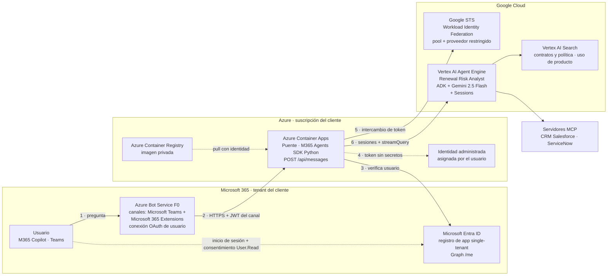
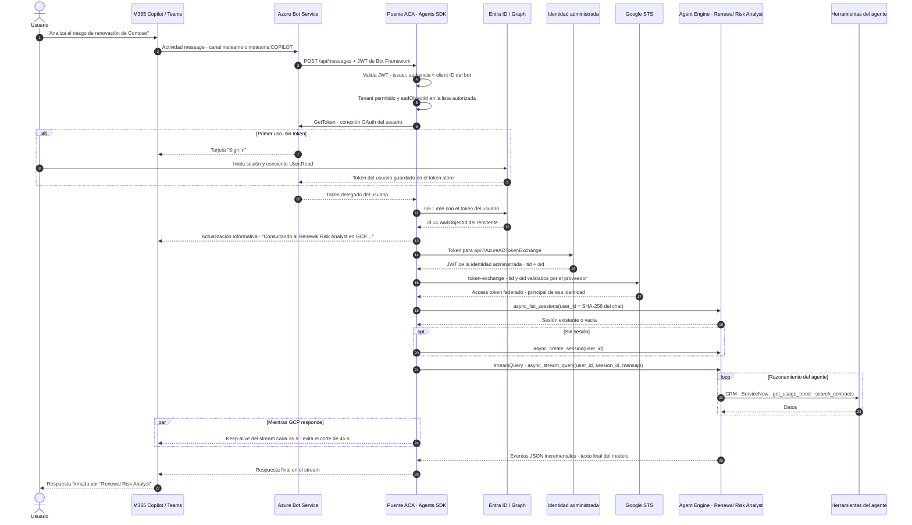

# Integrar un agente externo en Microsoft 365 Copilot — Renewal Risk Analyst (GCP)

Esta carpeta contiene un **custom engine agent** construido con el
**Microsoft 365 Agents SDK** que permite usar desde **Microsoft 365 Copilot y Teams**
un agente que vive en **otra nube**: el *Renewal Risk Analyst* desplegado en
**Google Cloud Vertex AI Agent Engine**.

El patrón sigue la guía de Microsoft
[Bring your agents into Microsoft 365 Copilot](https://learn.microsoft.com/es-es/microsoft-365/copilot/extensibility/bring-agents-to-copilot):
el agente existente no se reescribe; se le añade un *wrapper* con el Agents SDK que
recibe los mensajes del canal y los reenvía al agente remoto.

> **Principio clave:** el puente **no copia ni reimplementa** el agente de GCP.
> No contiene prompts de negocio, herramientas, scoring ni llamadas a Gemini.
> El modelo, las herramientas, los datos y el historial siguen en GCP.

**Estado del piloto:** verificado de extremo a extremo en
**Teams**, **M365 Copilot web** y **app de Copilot para Windows**, con análisis
reales de Contoso servidos por el agente de GCP.

---

## 1. Arquitectura



| Componente | Función | Dónde |
|---|---|---|
| **App en M365** (manifiesto v1.22, `copilotAgents.customEngineAgents`) | Hace visible el agente en Copilot y Teams | Catálogo de apps del tenant |
| **Registro Entra + Azure Bot** | Identidad del agente, canales y conexión OAuth del usuario | Tenant / suscripción del cliente |
| **Puente** ([app.py](app.py), [engine.py](engine.py)) | Autentica y autoriza, mantiene la sesión por chat, invoca al agente remoto y devuelve la respuesta con streaming | Azure Container Apps |
| **Identidad administrada + Workload Identity Federation** | Acceso Azure → GCP **sin claves**, limitado a un único Agent Engine | Azure + GCP |
| **Agent Engine** | El agente original, sin cambios, con sus herramientas y su historial | GCP |

El puente es **sin estado**: no usa base de datos ni almacenamiento. La sesión de
cada chat se recupera de Agent Engine con `async_list_sessions(user_id)`, donde
`user_id` es un SHA-256 de *tenant + canal + conversación + usuario*.

---

## 2. Flujo detallado de una petición



Notas del flujo:

- La identidad del **usuario** se verifica en el puente (pasos 4–12). A GCP llega
  la **identidad técnica** del puente, no el token del usuario: el token de Entra
  del usuario **nunca** se envía a GCP ni se registra en logs.
- Teams y Copilot comparten el mismo Bot y el mismo puente. Copilot usa el
  subcanal `msteams:COPILOT` y conversaciones `19:…@thread.v2`.
- Un análisis completo tarda entre 30 s y 3 min. Copilot corta a los 45 s si no
  recibe nada, por eso el puente usa `StreamingResponse` del SDK: actualización
  informativa inmediata, *keep-alive* cada 35 s y, pasados 105 s, entrega la
  respuesta como mensaje normal.

---

## 3. Modelo de seguridad

| Capa | Control | Implementación |
|---|---|---|
| Canal → puente | Solo Bot Framework puede llamar a `/api/messages` | JWT validado por el SDK; sin JWT responde **401**. HTTPS obligatorio, HTTP redirige con 301. |
| Usuario → agente | Entra ID en cada mensaje | Conexión OAuth `User.Read` del Bot; tenant permitido; **lista explícita de object IDs**; Graph `/me` debe coincidir con el remitente. Si falla, **no se invoca a GCP**. |
| Puente → GCP | Identidad técnica sin claves | Identidad administrada de Azure → Workload Identity Federation. El proveedor solo acepta el issuer del tenant, la audiencia de token exchange y la condición `tid` **y** `oid` de esa identidad. |
| Alcance en GCP | Mínimo privilegio | El principal federado tiene `roles/aiplatform.user` **solo en la política IAM del Agent Engine**, no en el proyecto. Los datos se leen con la cuenta de servicio del propio agente. |
| Secretos | Ninguno en código ni en ficheros | Secreto del Bot como secreto de ACA, introducido de forma oculta por el administrador. Sin claves de cuenta de servicio de GCP. Imagen sin `.env` ni datos. |

**Control por agente:** si se añaden más agentes en GCP o AWS, el acceso se controla
en tres puntos: qué usuarios ven la app en M365 (disponibilidad por usuario o grupo),
la lista autorizada del puente y el permiso IAM **por recurso** en la nube de destino.
Un mismo puente puede servir a varios agentes con un permiso distinto por agente.

---

## 4. Guía paso a paso para el cliente

Valores del piloto entre corchetes. Sustituirlos por los del cliente.

### Fase 0 — Requisitos y decisiones

| Requisito | Detalle |
|---|---|
| Licencias | Usuarios con **Microsoft 365 Copilot** y Teams en el tenant donde se publicará el agente. |
| Tenant | Registro Entra, Azure Bot y publicación **en el mismo tenant que usa Copilot**. Recomendado alojar el puente en una suscripción de ese tenant. |
| Roles en Microsoft | Administrador de aplicaciones de Entra (registro, secreto, consentimiento), administrador de Teams o M365 para publicar la app, *Owner* o *Contributor* del grupo de recursos. |
| Roles en GCP | Administración de Workload Identity Pools (`roles/iam.workloadIdentityPoolAdmin`) e IAM sobre el Agent Engine. |
| Agente externo | Invocable por API con sesiones. En GCP, Agent Engine con `AdkApp`, que expone `async_create_session`, `async_list_sessions`, `async_stream_query` y `async_delete_session`. |
| Políticas | En tenants corporativos de Microsoft, las apps de Entra exigen un **Service Tree ID** (`serviceManagementReference`). Comprobar también políticas de almacenamiento, red y CAE del tenant. |

### Fase 1 — Agente desplegado en GCP

> **Configuración:** los identificadores del entorno (suscripción, tenant, IDs de
> apps, proyecto GCP, ACR, endpoints MCP…) no están en el código. Copiar
> [.env.example](.env.example) a `.env` (excluido de git) y rellenar la sección
> *Deployment settings*; los scripts de [scripts](scripts) la leen al arrancar y
> fallan indicando qué variable falta. En los comandos, `<sub>`, `<tenant>`, `<acr>`…
> son esos mismos valores.

1. Desplegar el agente **sin modificar su lógica**. Aquí se usó la fuente original
   ([gcp_agent/renewal_risk_agent](gcp_agent/renewal_risk_agent)) como
   `AdkApp` source-only con [deploy_gcp.py](scripts/deploy_gcp.py), con una cuenta
   de servicio propia (`renewal-risk-m365-agent@…`) y permisos de datos mínimos.
   El script pasa al runtime, como variables de entorno, el número de proyecto, el
   bucket de contratos y las URLs de los MCP de CRM y ServiceNow.
2. Anotar el recurso
   [`projects/<número>/locations/us-central1/reasoningEngines/<id>`] en
   `GCP_AGENT_RESOURCE`.
3. Validar la invocación remota con
   [verify_gcp.py](scripts/verify_gcp.py). Si las herramientas MCP escalan a cero,
   el primer arranque puede requerir inicializarlas.

### Fase 2 — Identidad del agente en Entra ID

En **Entra → App registrations → New registration**:

1. **Single tenant**, nombre descriptivo [`Renewal Risk Analyst M365 GCP Bridge Test`].
   Anotar el *client ID* en `BOT_APP_ID`.
2. **Authentication → Web → Redirect URI**:
   `https://token.botframework.com/.auth/web/redirect`.
3. **API permissions**: solo `Microsoft Graph · User.Read` (delegado).
4. **Certificates & secrets → New client secret** con caducidad corta. Copiar el
   valor una sola vez y **no guardarlo en ficheros ni enviarlo por chat**.

### Fase 3 — Azure Bot

1. Crear **Azure Bot**, plan **F0**, tipo **Single Tenant**, con el client ID y el tenant anteriores.
2. **Channels → Microsoft Teams**: añadirlo, **aceptar los términos** y aplicar
   *Microsoft Teams Commercial*.
3. **Channels → Microsoft 365 Extensions** (`M365Extensions`): **obligatorio para
   Copilot**. Sin él, Teams funciona pero Copilot no entrega los mensajes al agente.
4. **Configuration → OAuth Connection Settings → Add**: nombre
   [`BOT_OAUTH_CONNECTION_NAME`, por defecto `entra-user-read`],
   proveedor **Azure Active Directory v2**, client ID y secreto de la fase 2,
   *Tenant ID* del cliente (no `common`) y scope `User.Read`.
   Comprobar con **Test Connection**.
5. El *messaging endpoint* se rellena en la fase 7.

### Fase 4 — Puente con el Microsoft 365 Agents SDK

El código de esta carpeta ya implementa todo. Lo que aporta frente a un ejemplo *echo*:

| Responsabilidad | Dónde |
|---|---|
| Hosting aiohttp, `CloudAdapter`, validación JWT y `/healthz` | [app.py](app.py) |
| Ruta `message` protegida con el handler OAuth `ENTRA` y comprobaciones de tenant, lista autorizada y Graph | [app.py](app.py), [user_auth.py](user_auth.py) |
| Chats personales de Teams y chats 1:1 de Copilot (`msteams:COPILOT`); rechaza grupos y canales | [app.py](app.py) |
| Streaming hacia Copilot y Teams con `context.streaming_response` | [app.py](app.py) |
| Cliente REST de Agent Engine: sesiones por chat, `:streamQuery`, SSE o JSON incremental | [engine.py](engine.py) |
| Credencial GCP: ADC en local, identidad administrada + WIF en Azure | [gcp_auth.py](gcp_auth.py) |
| Configuración validada; falla al arrancar si falta seguridad | [config.py](config.py), [.env.example](.env.example) |

Comandos en el chat: `ayuda` y `reiniciar`; en Teams también `/help` y `/reset`.
**En Copilot, `/help` y otros comandos con barra los reserva el propio Copilot y no llegan al agente.**

### Fase 5 — Alojamiento en Azure Container Apps

```powershell
az group create --name rg-renewal-risk-m365-aca --location eastus --subscription <sub>
az deployment group create --resource-group rg-renewal-risk-m365-aca --subscription <sub> `
  --template-file .\infra\aca-foundation.bicep --parameters registryName=<acr> `
  --query properties.outputs -o json > .\data\aca-bridge-foundation.json
```

[aca-foundation.bicep](infra/aca-foundation.bicep) crea un ACR privado con el administrador
deshabilitado, una identidad administrada con `AcrPull` limitado a ese ACR y un
entorno ACA *Consumption*. Después, construir la imagen ([Dockerfile](Dockerfile),
usuario no root, solo el runtime) en el ACR y usar siempre el **digest inmutable**:

```powershell
az acr build --registry <acr> --subscription <sub> --image renewal-risk-m365:<tag> --no-logs .
az acr repository show --name <acr> --image renewal-risk-m365:<tag> --query digest -o tsv
```

### Fase 6 — Confianza Azure → GCP sin claves (Workload Identity Federation)

1. Desplegar la sonda sin ingress ni credenciales del bot
   ([aca-probe.bicep](infra/aca-probe.bicep), `mode=identity`, con los parámetros
   `gcpWorkloadIdentityAudience`, `gcpAgentResource` y `m365TenantId`) y leer los claims
   reales con `az containerapp logs show --type console`. La sonda imprime solo
   `iss`, `aud`, `oid` y `tid`. En el piloto:
   `iss = https://login.microsoftonline.com/<tenant>/v2.0`,
   `aud = fb60f99c-7a34-4190-8149-302f77469936` (el *app ID* de AzureADTokenExchange,
   no la URI `api://…`), `oid = <principal de la identidad administrada>`.
2. Crear pool, proveedor y permiso con los valores **observados**:

   ```powershell
   .\.venv\Scripts\python.exe .\scripts\deploy_federation.py --apply `
     --principal <oid> --issuer https://login.microsoftonline.com/<tenant>/v2.0 `
     --audience fb60f99c-7a34-4190-8149-302f77469936
   ```

   [deploy_federation.py](scripts/deploy_federation.py) crea el pool [`renewal-m365-azure`]
   y el proveedor [`GCP_WIF_PROVIDER_ID`, por defecto `azure`] con la condición `tid` + `oid`, y añade
   `roles/aiplatform.user` al principal federado **solo en la política del Agent
   Engine**, conservando el `etag` y los bindings existentes.
3. Volver a desplegar la sonda con `mode=backend`: debe registrar
   `{"backend_query": true}`, una consulta real a GCP desde Azure sin claves.

### Fase 7 — Desplegar el runtime y conectar el Bot

```powershell
az login --tenant <tenant>; az account set --subscription <sub>
az bicep build --file .\infra\containerapp.bicep --outfile .\data\containerapp.compiled.json
.\.venv\Scripts\python.exe .\scripts\deploy_aca.py --apply --image <acr>.azurecr.io/renewal-risk-m365@sha256:<digest>
```

[deploy_aca.py](scripts/deploy_aca.py) pide el secreto de la fase 2 **de forma oculta**,
crea o actualiza la conexión OAuth, despliega [containerapp.bicep](infra/containerapp.bicep)
con el secreto como parámetro seguro y como secreto de ACA, y configura el
*messaging endpoint* del Bot en `https://<fqdn>/api/messages`. Las actualizaciones
posteriores reutilizan el secreto de ACA; `--rotate` pide uno nuevo.

Comprobar:

```powershell
Invoke-WebRequest https://<fqdn>/healthz                     # 200
Invoke-WebRequest https://<fqdn>/api/messages -Method Post   # 401 sin JWT
```

### Fase 8 — Paquete de la app y publicación en M365

```powershell
.\.venv\Scripts\python.exe .\scripts\build_package.py --bot-id <client-id> --domain <fqdn> `
  --developer "<empresa>" --website <url> --privacy <url> --terms <url>
```

Genera `dist\renewal-risk-agent.zip` a partir de
[manifest.template.json](appPackage/manifest.template.json): manifiesto **1.22**,
`bots` en scope `personal`, `copilotAgents.customEngineAgents` con el mismo ID del
bot y `validDomains` con el dominio del puente **y `token.botframework.com`**, que
es necesario para la ventana de inicio de sesión.

Publicación (administrador):

- **Teams → Aplicaciones → Administrar sus aplicaciones → Cargar una aplicación →
  Cargar una aplicación en el catálogo de su organización**, o
- **admin.cloud.microsoft → Configuración → Aplicaciones integradas**, que además
  permite **limitar la disponibilidad a usuarios o grupos**.

Si cambia el manifiesto, incrementar `version` y volver a subir el ZIP. Los cambios
de código del puente **no** requieren un ZIP nuevo.

### Fase 9 — Pruebas de aceptación

1. **Teams → chat con el agente** → `ayuda` → tarjeta **Sign in** → consentir
   `User.Read` (solo para el usuario; no es necesario el consentimiento de la organización).
2. `Analiza el riesgo de renovación de Contoso y prepara un email` → respuesta con
   señales, fuentes y borrador.
3. **Copilot** (web y app): **Agentes → Renewal Risk Analyst → chat nuevo**, misma
   pregunta. La respuesta debe aparecer firmada como *Renewal Risk Analyst*.
   Si aparece firmada como *Copilot* con citas a chats, es Copilot general
   resumiendo conversaciones anteriores, no el agente.
4. Negativos: usuario no incluido en la lista → rechazo sin llamar a GCP;
   `POST /api/messages` sin JWT → 401.

---

## 5. Demostración: ver en GCP cómo llegó la petición y qué respondió

Objetivo: enseñar al cliente que la pregunta hecha en Copilot llega al agente de
GCP, qué herramientas usa el agente y qué responde.

### Paso 1 — Hacer la pregunta en Copilot

`Analiza el riesgo de renovación de Contoso`. Anotar la hora.

### Paso 2 — Correlación en el puente (Azure)

```powershell
az containerapp logs show --name ca-renewal-risk-m365 --resource-group rg-renewal-risk-m365-aca `
  --subscription <sub> --type console --tail 300 --format text |
  Select-String "Invoking GCP agent|Agent Engine session|GCP answered|POST /api/messages"
```

Se ven, por este orden (salida real del piloto con la pregunta sobre Northwind):

```text
INFO:__main__:Invoking GCP agent: channel=msteams:COPILOT key=ea97c97dd1ed streaming=True
INFO:engine:Agent Engine session=444857628594536448 key=ea97c97dd1ed (reused)
INFO:__main__:GCP answered key=ea97c97dd1ed in 21.7s (5086 chars)
INFO:aiohttp.access:... "POST /api/messages HTTP/1.1" 202 ... "Microsoft-SkypeBotApi (Microsoft-BotFramework/3.0)"
```

`channel=msteams:COPILOT` confirma que la petición viene de Copilot; en Teams es `msteams`.
`key` son los primeros caracteres del `user_id` de la sesión en GCP y `session` es
su ID en Agent Engine. El contenido de los mensajes no se escribe en los logs del puente.

### Paso 3 — La conversación vista desde GCP (Agent Engine Sessions)

Con una cuenta GCP con permisos de lectura sobre el Agent Engine
(`gcloud auth application-default login`):

```powershell
.\.venv\Scripts\python.exe .\scripts\show_gcp_trace.py --session <session-id>
# o bien por clave del puente:
.\.venv\Scripts\python.exe .\scripts\show_gcp_trace.py --key <key>
```

[show_gcp_trace.py](scripts/show_gcp_trace.py), de solo lectura, lista las últimas
sesiones del agente y muestra los eventos de la elegida. Salida real, abreviada:

```text
=== Events of session 444857628594536448 ===
11:36:33 user                   M365 USER   analiza el riesgo de renovación de Northwind y prepara el borrador de email
11:36:33 renewal_risk_agent     TOOL CALL   find_account_by_name({"name": "Northwind Traders"})
11:36:36 renewal_risk_agent     TOOL RESULT find_account_by_name: {"content": [{"type": "text", "text": "{\n \"status\": 200, ...
11:36:36 renewal_risk_agent     TOOL CALL   get_account({"account_id": "001000000001003AAA"})
11:36:36 renewal_risk_agent     TOOL CALL   list_opportunities_by_account({"account_id": "001000000001003AAA"})
11:36:37 renewal_risk_agent     TOOL RESULT list_opportunities_by_account: {... "totalSize": 2, "records": [ ...
11:36:37 renewal_risk_agent     TOOL CALL   get_usage_trend({"name_or_id": "Northwind Traders"})
11:36:39 renewal_risk_agent     TOOL RESULT get_usage_trend: {"found": true, "customer_id": "C1003", "months": [ ...
11:36:39 renewal_risk_agent     AGENT REPLY Riesgo de Renovación para Northwind Traders: **ALTO** **Señales de riesgo:** ...
```

En el análisis de Contoso del mismo chat aparecen también `list_accounts`,
`search_contracts` (`renewal_policy.txt`, `contract_contoso.txt`,
`support_notes_contoso.txt`) y `get_usage_trend`. Las herramientas `*_account*` y
`*_opportunit*` son del MCP de CRM; `get_usage_trend` y `search_contracts`
consultan Vertex AI Search.

> Copilot envía el texto del compositor como HTML enriquecido (por ejemplo
> `<strong data-lexical-text>` o `<br>`). El puente lo convierte a texto plano antes
> de enviarlo al agente, sin cambiar el contenido. Esta sesión es anterior a ese
> cambio, así que en GCP la línea `M365 USER` contiene ese HTML; arriba se muestra
> limpia para facilitar la lectura.

Esto demuestra que el mensaje del usuario de Copilot es lo que recibe el agente,
que el razonamiento y las herramientas se ejecutan **en GCP** y que la respuesta
de Copilot es la del agente.

### Paso 4 — Consola de Google Cloud

- **Agent Platform → Deployments**:
  [console.cloud.google.com/agent-platform/runtimes](https://console.cloud.google.com/agent-platform/runtimes)
  (proyecto `GCP_PROJECT_ID`)
  → *renewal-risk-analyst-m365*: métricas de peticiones, latencia y errores del agente.
- **Logs Explorer**, logs del runtime del agente:

  ```text
  resource.type="aiplatform.googleapis.com/ReasoningEngine"
  resource.labels.reasoning_engine_id="<id de GCP_AGENT_RESOURCE>"
  ```

  Las llamadas por streaming aparecen como `POST /api/stream_reasoning_engine` y
  las de sesiones como `POST /api/reasoning_engine`.

### Paso 5 (opcional) — Demostrar que quien llama es la identidad federada de Azure

Activar en **IAM y administración → Registros de auditoría → Vertex AI API** los
registros *Data Read* y *Data Write*. Tienen coste de ingesta. Después, en Logs Explorer:

```text
logName:"cloudaudit.googleapis.com%2Fdata_access"
protoPayload.serviceName="aiplatform.googleapis.com"
protoPayload.resourceName:"reasoningEngines/<id>"
```

El campo `protoPayload.authenticationInfo.principalSubject` mostrará
`principal://iam.googleapis.com/projects/<número>/locations/global/workloadIdentityPools/renewal-m365-azure/subject/<oid>`,
es decir, la identidad administrada de Azure, sin claves ni cuentas de usuario de GCP.

---

## 6. Problemas encontrados y solución

| Síntoma | Causa | Solución |
|---|---|---|
| Copilot responde *"Lo siento, no pude responder a eso"* y no llega nada al puente; en Teams sí funciona | Falta el canal **Microsoft 365 Extensions** en el Azure Bot | Añadir el canal `M365Extensions` |
| Copilot contesta *"To get the current conversation ID, type /debug…"* | `/help` es un comando reservado de Copilot | Usar `ayuda` y `reiniciar` |
| Copilot recibe el mensaje pero el puente lo descarta | Copilot usa `msteams:COPILOT` y conversación `19:…@thread.v2`, no `personal` | Aceptar el subcanal Copilot, ya implementado |
| *"timeout error after 45000ms"* aunque el puente termina bien | Copilot exige actividad en menos de 45 s | `StreamingResponse` con actualización informativa y keep-alive |
| Respuesta firmada por "Copilot" con citas a chats | Se escribió en Copilot general, no dentro del agente | Abrir **Agentes → Renewal Risk Analyst** |
| La app de escritorio no responde y la web sí | Cliente desactualizado o caché | Pulsar **Actualizar** o reiniciar Teams/Copilot |
| No aparece *Cargar una aplicación personalizada* | Sideloading deshabilitado por directiva | Publicar en el catálogo de la organización como administrador |
| Graph desde Azure CLI: `TokenCreatedWithOutdatedPolicies` (CAE) | Token cacheado anterior a una política de acceso | Crear el secreto en el portal; el script no usa Graph |
| Tenant corporativo de Microsoft: `ServiceManagementReference can't be null` | Las apps de Entra exigen un Service Tree ID válido | Usar un Service Tree ID de un servicio activo, o un tenant de pruebas |
| ACA no monta Azure Files: `mount error(13)` | Cuentas de almacenamiento con acceso público y clave compartida deshabilitados por política | **Diseño sin estado**: sesiones en Agent Engine, sin almacenamiento |
| WIF rechaza el token | La `aud` real del token MI es el GUID `fb60f99c-…`, no `api://AzureADTokenExchange` | Configurar el proveedor con los claims **observados** por la sonda |
| GCP 400 al crear el pool o proveedor | `displayName` de más de 32 caracteres | Nombres cortos |
| GCP 403 justo después de conceder un rol | Propagación de IAM | Esperar 1–7 minutos |

---

## 7. Operación y costes

| Recurso | Coste orientativo | Nota |
|---|---|---|
| Azure Bot | F0, gratuito | Canales estándar |
| Container Apps | Consumo, vCPU 0,5 y 1 GiB | `deploy_aca.py` deja `minReplicas=1` para pruebas. Tras la demo, bajar a 0 (`az containerapp update --min-replicas 0`); el arranque en frío cabe en la ventana de Copilot gracias al streaming |
| ACR Basic | ~5 USD/mes | |
| Agent Engine, Gemini, Vertex AI Search, MCP | Según uso en GCP | Cada pregunta ejecuta el agente real |

- **Una réplica como máximo**: los turnos de cada chat se serializan en memoria.
- **Rotación del secreto**: crear uno nuevo en Entra y ejecutar
  `deploy_aca.py --apply --image <digest> --rotate`.
- **Logs del puente**: `az containerapp logs show … --type console`. No contienen
  tokens ni el contenido de los mensajes, solo metadatos y tiempos.
- **Sin reintentos automáticos**: un timeout no cancela necesariamente la ejecución
  en GCP. El agente original mantiene su flujo de aprobación para acciones de escritura.
- **Residencia y privacidad**: los mensajes salen de M365 hacia GCP y hacia las
  herramientas del agente. Reflejarlo en las aprobaciones del cliente.

---

## 8. Recursos del piloto

Los valores concretos de cada entorno están en `.env` (ver [.env.example](.env.example)).

| Recurso | Valor |
|---|---|
| Tenant / suscripción | `ENTRA_TENANT_ID` / `AZURE_SUBSCRIPTION_ID` |
| Registro Entra | `Renewal Risk Analyst M365 GCP Bridge Test`, client ID `BOT_APP_ID` |
| Azure Bot | `BOT_NAME` (F0, `rg-renewal-risk-m365-test`): Teams + Microsoft 365 Extensions, OAuth `BOT_OAUTH_CONNECTION_NAME` |
| Puente | `ca-renewal-risk-m365` en `rg-renewal-risk-m365-aca` (East US): `https://ca-renewal-risk-m365.<dominio-del-entorno>.eastus.azurecontainerapps.io` |
| ACR / identidad | `ACR_NAME` / `id-renewal-risk-m365` |
| Usuarios autorizados | `PILOT_ALLOWED_USER_IDS` (object IDs de Entra) |
| GCP | Proyecto `GCP_PROJECT_ID`; Agent Engine `GCP_AGENT_RESOURCE`; pool `renewal-m365-azure`, proveedor `GCP_WIF_PROVIDER_ID` |

Este piloto **no habilita el Copilot corporativo**: allí hay que repetir las fases
2, 3 y 8 en el tenant corporativo, con Service Tree ID.

---

## 9. Desarrollo local y pruebas

```powershell
py -3.12 -m venv .venv
.\.venv\Scripts\python.exe -m pip install -r .\requirements-dev.txt
Copy-Item .\.env.example .\.env      # LOCAL_DEVELOPMENT=true, GCP_AGENT_RESOURCE=...
gcloud auth application-default login
.\.venv\Scripts\python.exe .\app.py
npx @microsoft/teams-app-test-tool   # Agents Playground -> http://127.0.0.1:3978/api/messages
```

El modo local es anónimo y **solo en loopback**; no exponerlo con túneles.

```powershell
.\.venv\Scripts\python.exe -m pytest -q
.\.venv\Scripts\python.exe -m ruff check .
```

Las pruebas cubren el `CloudAdapter` real, el rechazo sin JWT, OAuth obligatorio,
Graph, tenant y lista autorizada, chats de Copilot frente a grupos, streaming,
sesiones remotas tras reinicio, reinicio por chat, concurrencia, SSE/JSON
fragmentado, federación y paquete M365. Usan servicios simulados; la validación
real es la de las fases 6, 7 y 9.

| Archivo | Función |
|---|---|
| [app.py](app.py) | Endpoint, Agents SDK, autorización, comandos y streaming |
| [engine.py](engine.py) | Cliente REST de Agent Engine sin estado local; sin ADK |
| [user_auth.py](user_auth.py) | Verificación Graph `/me` |
| [gcp_auth.py](gcp_auth.py) | ADC local o identidad administrada + WIF |
| [config.py](config.py), [.env.example](.env.example) | Configuración validada |
| [appPackage](appPackage), [build_package.py](scripts/build_package.py) | Manifiesto y paquete M365 |
| [Dockerfile](Dockerfile), [infra](infra) | Imagen y Bicep: base ACA, sonda y runtime |
| [deploy_aca.py](scripts/deploy_aca.py) | OAuth del Bot, runtime ACA y endpoint del Bot |
| [deploy_federation.py](scripts/deploy_federation.py) | Federación GCP y permiso por recurso |
| [probe_aca.py](scripts/probe_aca.py) | Sondas de operador: claims y consulta real |
| [deploy_gcp.py](scripts/deploy_gcp.py), [verify_gcp.py](scripts/verify_gcp.py) | Despliegue y smoke del agente original en Agent Engine |
| [local_env.py](scripts/local_env.py) | Lee la sección *Deployment settings* de `.env` para los scripts |
| [gcp_agent/renewal_risk_agent](gcp_agent/renewal_risk_agent) | Fuente original del agente ADK que despliega `deploy_gcp.py`; solo se sacaron a variables de entorno los identificadores del proyecto, el bucket y las URLs MCP |
| [show_gcp_trace.py](scripts/show_gcp_trace.py) | Demostración: conversación vista desde GCP |

Referencias:
[Bring your agents into Microsoft 365 Copilot](https://learn.microsoft.com/es-es/microsoft-365/copilot/extensibility/bring-agents-to-copilot) ·
[Custom engine agents](https://learn.microsoft.com/en-us/microsoft-365/copilot/extensibility/overview-custom-engine-agent) ·
[Streaming en Teams y Copilot](https://learn.microsoft.com/en-us/microsoftteams/platform/bots/streaming-ux) ·
[Agents SDK para Python](https://github.com/microsoft/Agents-for-python) ·
[Agent Engine: logging](https://docs.cloud.google.com/gemini-enterprise-agent-platform/scale/runtime/logging) ·
[Workload Identity Federation con Azure](https://cloud.google.com/iam/docs/workload-identity-federation-with-other-clouds)
