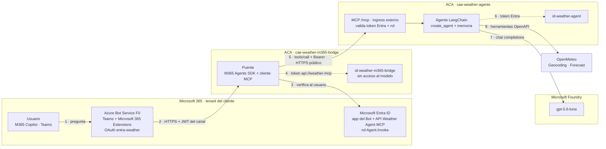
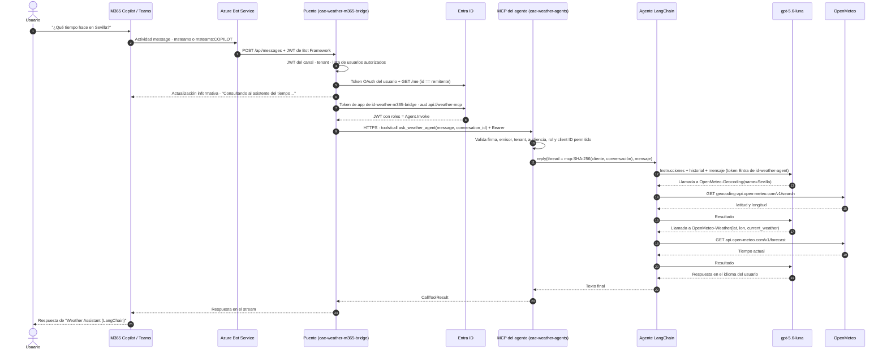
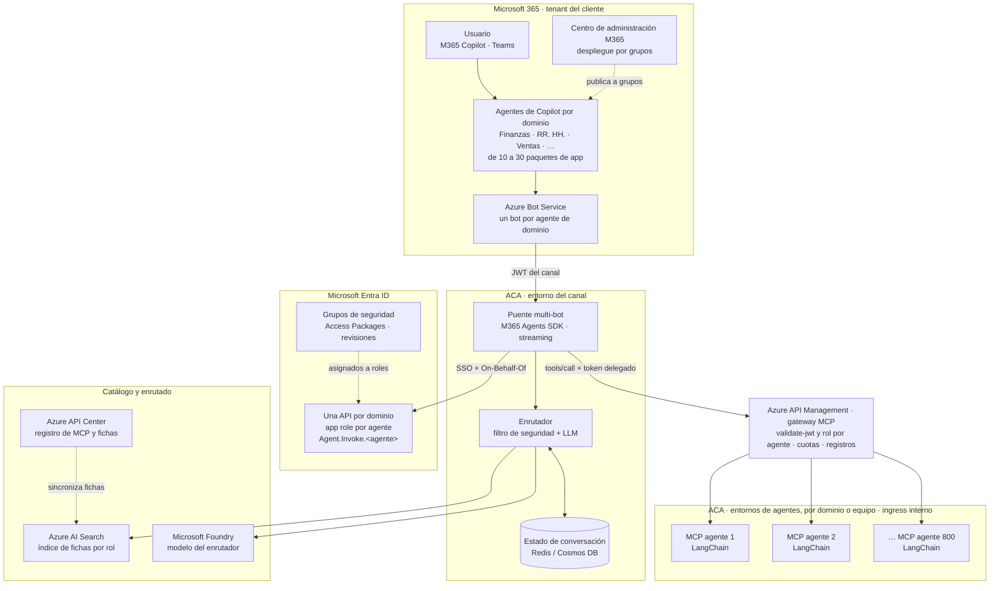
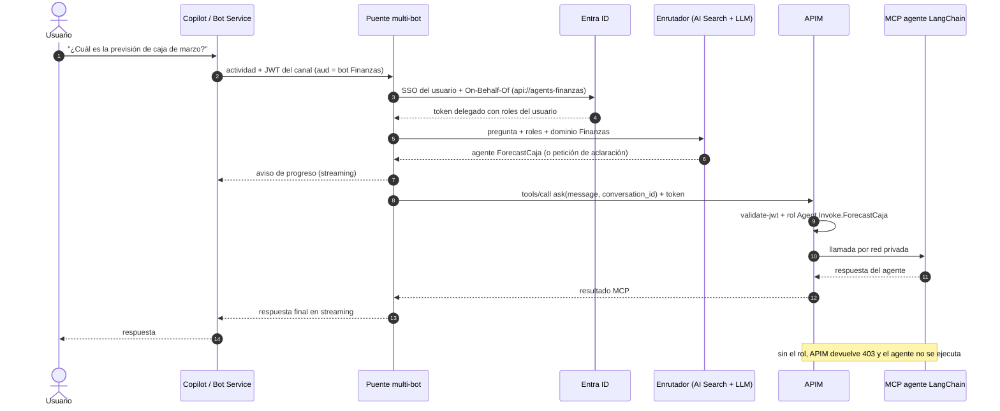

# Weather Assistant (LangChain) — M365 Copilot → puente (ACA) → MCP → agente LangChain (ACA)

Tercera versión de la integración de **Microsoft 365 Copilot** con agentes externos,
independiente de las dos anteriores
([versión directa a GCP](../m365-renewal-risk-agent/README.md) y
[versión MCP a GCP](../m365-renewal-risk-agent-mcp/README.md)).

Aquí el agente es un **agente LangChain desplegado en Azure Container Apps** y expuesto
mediante **MCP** en su propio entorno ACA. El puente de M365 vive en **otro entorno ACA
independiente**. Es el patrón de un cliente cuya plataforma de agentes LangChain corre
en ACA y quiere publicarlos en Copilot sin reescribirlos. El
[capítulo 10](#10-escalabilidad-de-un-agente-a-800-opción-b) explica cómo escalar este
patrón a cientos de agentes con permisos por usuario en Entra ID.

**Estado:** desplegado:

- **Teams:** probado con éxito.
- **Dentro de Azure:** validado de extremo a extremo. Una consulta desde el contenedor del
  puente, en el otro entorno ACA, recorre token Entra → MCP público protegido → agente
  LangChain → `gpt-5.6-luna` → OpenMeteo, y responde en el idioma de la pregunta.
- **Copilot:** la primera petición llegó correctamente, pero falló por un timeout de
  OpenMeteo, que ya está corregido. Falta repetir la prueba en Copilot con esa corrección.

---

## 1. El agente

**Instrucciones** (literales, en [agent.py](weather-agent/agent.py)): asistente del tiempo
que responde **siempre en el idioma del último mensaje** del usuario, **pide la
ubicación** si falta, y para una ciudad usa **siempre** las herramientas:

1. `OpenMeteo-Geocoding`, operación *Search location* → latitud y longitud del primer resultado.
2. `OpenMeteo-Weather`, operación *Get weather forecast* → tiempo actual.

**Herramientas:** se generan **desde las mismas definiciones OpenAPI** que usa Copilot
Studio ([openapi/](weather-agent/openapi)), sin reescribirlas a mano.
[openapi_tools.py](weather-agent/openapi_tools.py) convierte cada operación Swagger 2.0
en una herramienta de LangChain con nombre, descripción y argumentos tipados. Cada
herramienta **solo puede llamar al host declarado en su especificación**, por HTTPS, sin
redirecciones, con un reintento y error controlado si el servicio no responde.

| Herramienta | Operación | Llamada |
|---|---|---|
| `OpenMeteo-Geocoding` | *Search location* (`searchLocation`) | `GET https://geocoding-api.open-meteo.com/v1/search?name=&count=1` |
| `OpenMeteo-Weather` | *Get weather forecast* (`getWeatherForecast`) | `GET https://api.open-meteo.com/v1/forecast?latitude=&longitude=&current_weather=true` |

**Modelo:** `gpt-5.6-luna` de un recurso de Microsoft Foundry (`FOUNDRY_NAME`), con **Entra ID**: identidad
administrada, sin claves; el recurso tiene la autenticación por clave desactivada.
**Memoria:** por conversación, con `InMemorySaver` de LangGraph, de modo que "¿Y en
Madrid?" entiende el contexto. Se pierde al reiniciar la réplica.

---

## 2. Arquitectura



| Decisión | Motivo |
|---|---|
| **Entornos ACA separados** | La plataforma de agentes y el canal M365 tienen ciclos de vida, equipos y redes distintos. |
| **MCP con ingress externo + Entra** | El ingress interno de ACA no es accesible desde otro entorno. El MCP se publica por HTTPS y **toda llamada exige** un token Entra de app con audiencia `api://<weather-mcp>` y rol `Agent.Invoke`. La API exige asignación del rol y el MCP solo admite el client ID del puente. Alternativas: red virtual compartida o APIM delante. |
| **Un MCP por agente** | Cada agente expone su contrato MCP y tiene su propia identidad. Solo `id-weather-agent` puede usar el modelo. |
| **Puente sin acceso al modelo ni a las herramientas** | Solo puede invocar al agente a través del MCP. |

---

## 3. Flujo detallado



---

## 4. Contrato MCP

| Herramienta | Entrada | Salida |
|---|---|---|
| `ask_weather_agent` | `message` (1–8000 caracteres), `conversation_id` (1–256 caracteres opacos) | Respuesta del agente en el idioma del usuario. Progreso cada 15 s si tarda |
| `reset_conversation` | `conversation_id` | Olvida el historial de esa conversación para ese consumidor |

- Endpoint: `https://ca-weather-agent-mcp.<dominio-del-entorno>.eastus.azurecontainerapps.io/mcp`,
  Streamable HTTP sin estado (MCP SDK 2.3). `/healthz` es público y no expone nada.
- Sin token: **401**. Con un token de otra audiencia, sin el rol o de un cliente no permitido: rechazado.
- Los errores internos, del modelo o de la API, se devuelven al consumidor con una
  referencia; el detalle solo queda en los logs del agente.

Otro consumidor, como un agente LangChain o un orquestador en otra ACA, se incorpora
igual que en la versión MCP: asignar a su identidad el rol `Agent.Invoke` de la API
*Weather Agent MCP - LangChain* y añadir su client ID a `allowedClientIds`.

---

## 5. Despliegue

Los requisitos y las fases comunes, como el Bot, los canales y el paquete M365, están
en la [guía de la versión directa](../m365-renewal-risk-agent/README.md#4-guía-paso-a-paso-para-el-cliente).
Antes, copiar [.env.example](.env.example) a `.env` (excluido de git) y rellenar
suscripción, tenant, usuarios autorizados, ACR y recurso de Foundry; el script lo lee al
arrancar. En los comandos, `<sub>`, `<acr>` y `<foundry>` son esos mismos valores.

```powershell
# 1. Base: dos entornos ACA separados, dos identidades, AcrPull,
#    y "Cognitive Services OpenAI User" sobre el recurso de Foundry solo para id-weather-agent
az deployment group create -g rg-renewal-risk-m365-aca --subscription <sub> `
  --template-file .\infra\foundation-weather.bicep `
  --parameters registryName=<acr> foundryName=<foundry> `
  --query properties.outputs -o json > .\data\foundation-weather.json

# 2. Imágenes
az acr build -r <acr> --image weather-agent-mcp:<tag>   --no-logs .\weather-agent
az acr build -r <acr> --image weather-m365-bridge:<tag> --no-logs .\bridge

# 3. Entra + Bot + las dos Container Apps + endpoint del Bot
.\.venv\Scripts\python.exe .\scripts\deploy_weather_stack.py --apply `
  --mcp-image <acr>/weather-agent-mcp@sha256:<d> --bridge-image <acr>/weather-m365-bridge@sha256:<d>

# 4. Paquete M365 (app "Weather Assistant (LangChain)", icono verde)
cd bridge; ..\.venv\Scripts\python.exe .\scripts\build_package.py --bot-id <bot-app-id> --domain <fqdn-del-puente> `
  --developer "<empresa>" --website <url> --privacy <url> --terms <url>
```

[deploy_weather_stack.py](scripts/deploy_weather_stack.py) sigue el mismo patrón que la
versión MCP:

- **Primera ejecución, o con `--entra`:** inicio de sesión interactivo en Entra para crear
  la API con el rol `Agent.Invoke`, asignar el rol a la identidad del puente y crear el
  registro del Bot. El secreto se rota y solo vive en memoria, en ACA y en la conexión OAuth.
- **ARM:** el Bot (F0, Teams + Microsoft 365 Extensions, OAuth), el agente
  ([weather-agent.bicep](infra/weather-agent.bicep)), el puente
  ([bridge.bicep](infra/bridge.bicep)) y el endpoint del Bot.
- **Reintentos:** las llamadas a ARM se reintentan ante timeouts, que ocurren a veces al
  crear canales del Bot.

---

## 6. Demostración: seguir una petición

```powershell
# Puente: de qué canal llega (msteams o msteams:COPILOT) y cuánto tarda
az containerapp logs show -n ca-weather-m365-bridge -g rg-renewal-risk-m365-aca --subscription <sub> `
  --type console --tail 200 --format text | Select-String "Invoking MCP agent|MCP answered"

# Agente: quién llama (client ID de la identidad del puente) y llamadas al modelo
az containerapp logs show -n ca-weather-agent-mcp -g rg-renewal-risk-m365-aca --subscription <sub> `
  --type console --tail 200 --format text | Select-String "tools/call|chat/completions"
```

Salida real del puente, para una pregunta hecha en Teams:

```text
INFO:__main__:Invoking MCP agent: channel=msteams key=d0e41d17e2a4 streaming=True
INFO:__main__:MCP answered key=d0e41d17e2a4 in 4.4s (106 chars)
```

Salida real del agente, para una consulta de prueba desde el contenedor del puente.
Hay tres llamadas al modelo: decidir el geocoding, decidir la previsión y redactar la
respuesta. Entre ellas van las dos llamadas a OpenMeteo, que no se registran:

```text
INFO:weather_agent_mcp:tools/call ask caller=<bridge-client-id> thread=ee214bdd584f
INFO:httpx2:HTTP Request: POST https://<foundry>.openai.azure.com/openai/deployments/gpt-5.6-luna/chat/completions?api-version=2025-04-01-preview "HTTP/1.1 200 OK"
INFO:httpx2:HTTP Request: POST https://<foundry>.openai.azure.com/openai/deployments/gpt-5.6-luna/chat/completions?api-version=2025-04-01-preview "HTTP/1.1 200 OK"
INFO:httpx2:HTTP Request: POST https://<foundry>.openai.azure.com/openai/deployments/gpt-5.6-luna/chat/completions?api-version=2025-04-01-preview "HTTP/1.1 200 OK"
INFO:weather_agent_mcp:tools/call ask thread=ee214bdd584f answered in 10.4s (216 chars)
```

`caller` es el client ID de `id-weather-m365-bridge`: el agente sabe qué
consumidor le llama, autenticado por Entra.

> **Comportamiento a tener en cuenta:** las instrucciones dicen *"Read latitude and
> longitude from the first result"*, y el agente las cumple al pie de la letra. Una
> ciudad ambigua puede resolverse a otra con el mismo nombre: en una prueba, "Lisbonne"
> se resolvió como Lisbonne (Hainaut, Bélgica) en lugar de Lisboa, aunque el agente lo
> indicó en la respuesta. Para evitarlo, el usuario puede añadir el país, o se pueden
> ajustar las instrucciones o el parámetro `count` del geocoding.

> **Fiabilidad de OpenMeteo:** la API pública a veces tarda más de 20 s. Cada herramienta
> reintenta una vez y, si vuelve a fallar, devuelve el error al modelo, que se lo explica
> al usuario en lugar de abortar la conversación. Este caso se vio en una de las primeras
> pruebas desde Copilot.

---

## 7. Comparativa de las tres versiones

| | Directa (GCP) | MCP (GCP) | LangChain (esta) |
|---|---|---|---|
| Agente | ADK en Vertex AI Agent Engine | El mismo | LangChain en ACA |
| Acceso del puente al agente | REST de Agent Engine | MCP interno en el mismo entorno ACA | **MCP público protegido por Entra**, en otro entorno ACA |
| Quién tiene credenciales del backend | El puente (federación GCP) | Solo el adaptador MCP | Solo el agente (modelo y herramientas) |
| Modelo | Gemini 2.5 Flash (GCP) | El mismo | `gpt-5.6-luna` en Foundry, por Entra |
| Herramientas | MCP CRM y ServiceNow, Vertex AI Search | Las mismas | OpenAPI de OpenMeteo, generadas desde los JSON de Copilot Studio |
| Latencia típica | 20–150 s | 20–150 s | 4–10 s |

---

## 8. Recursos

Los identificadores concretos del entorno están en `.env` (ver [.env.example](.env.example))
y en el estado local `data/deploy-weather.json`, ambos excluidos de git.

| Recurso | Valor |
|---|---|
| Entorno del agente | `cae-weather-agents` (`<dominio-del-entorno>.eastus.azurecontainerapps.io`) → `ca-weather-agent-mcp` |
| Entorno del puente | `cae-weather-m365-bridge` (`<dominio-del-entorno>.eastus.azurecontainerapps.io`) → `ca-weather-m365-bridge` |
| Identidades | `id-weather-agent` (modelo) · `id-weather-m365-bridge` (solo MCP) |
| Modelo | `FOUNDRY_NAME` → deployment `gpt-5.6-luna` (rol *Cognitive Services OpenAI User* para `id-weather-agent`) |
| Entra | API `Weather Agent MCP - LangChain` (rol `Agent.Invoke`) · Bot `Weather Assistant M365 Bridge` |
| Bot | `BOT_NAME` (F0), OAuth `BOT_OAUTH_CONNECTION_NAME` |
| Paquete | `bridge\dist\weather-agent-langchain.zip` |

Sobre recursos ya existentes solo hay cambios aditivos: los roles sobre el recurso de Foundry para
`id-weather-agent` y para el admin de pruebas, dos `AcrPull` y dos repositorios nuevos en
el ACR. Las versiones anteriores no se han modificado.

**Costes:** dos Container Apps con `minReplicas=1` para la demo; el modelo y OpenMeteo
se pagan por uso (OpenMeteo es gratuito para uso no comercial). Tras la demo, volver a
desplegar con `--min-replicas 0`.

---

## 9. Desarrollo local y pruebas

```powershell
uv venv --python 3.12 .venv; .\.venv\Scripts\python.exe -m ensurepip
.\.venv\Scripts\python.exe -m pip install -r weather-agent\requirements.txt -r bridge\requirements.txt pytest pytest-asyncio ruff requests msal

# Agente + MCP local (anónimo, solo loopback), con tu az login para el modelo (rol OpenAI User)
cd weather-agent; Copy-Item .env.example .env; ..\.venv\Scripts\python.exe server.py
# Puente local contra ese MCP (Agents Playground)
cd ..\bridge;     Copy-Item .env.example .env; ..\.venv\Scripts\python.exe app.py

.\.venv\Scripts\python.exe -m pytest -q    # 57 pruebas
.\.venv\Scripts\python.exe -m ruff check .
```

Las pruebas cubren:

- **Herramientas:** generación desde los JSON, host fijo y parámetros, rechazo de
  especificaciones no soportadas, y reintento y error controlado ante una API lenta.
- **MCP:** herramientas, errores sin detalle interno, 401 sin token y validación Entra
  del rol.
- **Puente:** todo su comportamiento heredado: canal Copilot, streaming, OAuth, lista
  autorizada y cliente MCP con token de identidad administrada.

| Carpeta | Contenido |
|---|---|
| [weather-agent](weather-agent) | `agent.py` (LangChain e instrucciones), `openapi_tools.py`, `server.py` (MCP), `entra_auth.py`, `openapi/` |
| [bridge](bridge) | Puente Agents SDK con cliente MCP (`mcp_engine.py`, herramienta `ask_weather_agent`) |
| [infra](infra) | `foundation-weather.bicep`, `weather-agent.bicep`, `bridge.bicep` |
| [scripts](scripts) | `deploy_weather_stack.py`; `local_env.py` lee `.env` |

---

## 10. Escalabilidad: de un agente a 800 (opción B)

Este capítulo describe cómo llevar el patrón de esta demo a un cliente con **cientos de
agentes LangChain desplegados en ACA** (en el ejemplo, 800). Cada usuario solo debe poder
usar los agentes que le permita **Entra ID**. Es un diseño de referencia: lo construido y
desplegado es lo descrito en los capítulos 1 a 9.

### 10.1 Las dos opciones

| | **A.** Integrar el Agents SDK en cada agente | **B.** MCP de cada agente + puente común (recomendada) |
|---|---|---|
| Cambios en los agentes | 800 cambios de código: canal Bot Framework, OAuth, streaming, comandos | Ninguno si ya exponen MCP; si no, una plantilla común |
| Bots en Azure Bot Service y apps de Entra para el canal | 800 | Uno por agente de Copilot por dominio (de 10 a 30) |
| Paquetes de app en M365 | 800 | De 10 a 30 |
| Experiencia en Copilot | 800 entradas en la tienda de agentes | Pocos agentes por dominio que eligen el agente adecuado |
| Acoplamiento | Cada agente queda atado al canal de M365 | Los agentes no conocen M365; el mismo MCP sirve a otros consumidores |
| Actualizar el SDK o corregir un fallo del canal | 800 bases de código | Un puente |

La opción A solo se justifica para unos pocos agentes "estrella" que necesiten una
experiencia propia en Copilot. **La opción B reutiliza exactamente esta demo**
(puente → MCP → agente LangChain) y añade tres piezas para escalar:

- **Catálogo y enrutador:** el usuario no elige entre 800 agentes.
- **Gateway:** un único punto de control para los 800 MCP.
- **Permisos delegados del usuario:** sustituyen al token de app de la demo.

### 10.2 Arquitectura objetivo



Todas las piezas envían trazas a **Application Insights** con el mismo identificador de
correlación, desde la actividad de Copilot hasta el agente.

**Lectura del diagrama**

1. El administrador publica cada **agente de dominio** en Copilot solo a los grupos que lo usan.
2. Copilot entrega el mensaje al bot del dominio, y Bot Service al **puente multi-bot**.
3. El puente obtiene la identidad del usuario por SSO y, mediante **On-Behalf-Of**, un
   **token delegado** para la API del dominio. Ese token incluye los **roles** del usuario,
   es decir, los agentes a los que tiene acceso.
4. El **enrutador** busca en el índice de fichas **filtrando por esos roles**. Así el usuario
   nunca recibe ni puede invocar agentes no autorizados. Un LLM elige el agente o pide
   aclaración.
5. El puente llama a `tools/call` del MCP elegido **a través de APIM**. APIM vuelve a
   validar el token y el rol exacto del agente antes de llegar a ACA.
6. El agente LangChain responde. El puente transmite la respuesta a Copilot en streaming.

### 10.3 Componentes

| Componente | Responsabilidad | Cómo escala |
|---|---|---|
| **Agentes de Copilot por dominio** | Entrada del usuario en Copilot: nombre, icono, descripción, frases de inicio. Cada manifiesto declara un `customEngineAgent` con el ID de su bot. | Pocos paquetes; se añade uno por dominio nuevo, no por agente. |
| **Azure Bot Service** | Canales Teams y Microsoft 365 Extensions, y conexión OAuth (SSO) para el usuario. | Un bot por agente de dominio, todos con el mismo endpoint de mensajería. |
| **Puente multi-bot** (ACA) | Mismo código que esta demo: canal Copilot, streaming con progreso y normalización del texto. Además: identifica el bot, y con él el dominio, por el `aud` del JWT del canal. Pide el token OBO y llama al enrutador y al MCP. | Sin estado local: réplicas horizontales con reglas de escalado HTTP de ACA. |
| **Enrutador** (dentro del puente) | Elige qué agente atiende cada conversación. | Búsqueda acotada por los roles del usuario y los 5 mejores candidatos: el coste no crece con el número de agentes. |
| **Estado de conversación** | `conversation_id` → agente elegido, para no volver a enrutar en cada turno. La memoria del diálogo sigue en cada agente. | Redis o Cosmos DB con TTL. |
| **Azure API Center** | Registro oficial de los MCP. Cada agente tiene una ficha con descripción, dominio, responsable, rol requerido, ejemplos de preguntas, idiomas y endpoint. | Lo alimentan las canalizaciones de CI/CD de cada equipo. |
| **Azure AI Search** | Índice vectorial y de texto de las fichas, con el campo `requiredRole` filtrable. | Un índice, o uno por dominio. |
| **Azure API Management** | Gateway MCP único hacia los entornos ACA. Valida el JWT por ruta y rol, aplica cuotas por usuario y agente, centraliza registros y conecta por red privada con ingress interno. | Una operación por agente, con rutas `/{dominio}/{agente}/mcp`, generadas desde el catálogo. |
| **MCP de cada agente** (ACA) | Contrato estándar descrito en 10.5. | Varios entornos ACA, por dominio o por equipo, y escala a cero en los agentes poco usados. |
| **Entra ID** | Identidad del usuario, una API por dominio con un app role por agente, y grupos de seguridad. | Gestión con los procesos de identidad ya existentes (Access Packages, revisiones de acceso, PIM). |
| **Application Insights** | Traza con el mismo identificador de correlación desde Copilot hasta el agente. | Muestreo y registros por dominio. |

### 10.4 Permisos por usuario con Entra ID

En esta demo el puente llama al MCP con un **token de aplicación** de su identidad
administrada, y la autorización del usuario se hace en el puente con una lista. Para 800
agentes con permisos por usuario, el modelo pasa a ser **delegado**.

**Modelo de autorización**

- **Una API de Entra por dominio**, por ejemplo `api://agents-finanzas`, con **un app role
  por agente**: `Agent.Invoke.ForecastCaja`, `Agent.Invoke.Conciliacion`, etc.
  - Si se activa *Assignment required*, quien no tiene ningún rol del dominio ni siquiera
    obtiene token.
- **Los roles se asignan a grupos de seguridad, no a personas.**
  - Altas y bajas se gestionan con Access Packages y revisiones de acceso.
  - Los app roles evitan el exceso de grupos (*groups overage*, más de 200) que aparece si
    se usa el claim `groups`.
- **On-Behalf-Of en el puente.** Con el token SSO del usuario, obtenido mediante la
  conexión OAuth del bot, el puente pide un token delegado para la API del dominio.
  - En un token delegado, el claim `roles` contiene los app roles asignados al usuario,
    también los heredados por grupo.
  - El puente no consulta Graph para conocer los permisos.

  ```json
  { "aud": "api://agents-finanzas", "scp": "Agents.Invoke", "oid": "<usuario>",
    "roles": ["Agent.Invoke.ForecastCaja", "Agent.Invoke.Conciliacion"] }
  ```

- **Defensa en profundidad:**

  | Capa | Comprobación | Propósito |
  |---|---|---|
  | Centro de administración M365 | El agente de dominio solo se despliega a sus grupos | Visibilidad en Copilot |
  | Puente / enrutador | Filtro de seguridad `requiredRole in roles` en la búsqueda | Experiencia de usuario: solo ve lo permitido |
  | APIM | `validate-jwt`: firma, `tid`, `aud`, `scp` y el **rol exacto** del agente de la ruta | Bloqueo real aunque el puente fallara |
  | MCP del agente | Validación del token (la misma que [entra_auth.py](weather-agent/entra_auth.py)) | Protección si alguien llega sin pasar por APIM |
  | Sistemas que consulta el agente | OBO del agente hacia sus APIs, o identidad propia con permisos mínimos | Permisos sobre los **datos**, no solo sobre el agente |

- **Alternativa:** una app de Entra por agente (800, gestionables con IaC) da el máximo
  aislamiento. A cambio, el puente necesita un token por agente y el filtrado del catálogo
  exige consultar Graph. La API por dominio es el equilibrio recomendado.

**Secuencia de una petición con permisos**



### 10.5 Contrato estándar de cada agente MCP

Para que el puente y el enrutador traten a los 800 agentes por igual, todos cumplen el
mismo contrato. Esta demo ya lo sigue (capítulo 4).

| Elemento | Requisito |
|---|---|
| Herramienta principal | `ask(message: str, conversation_id: str) → str`. La memoria del agente se indexa por `conversation_id`. |
| Herramienta opcional | `reset(conversation_id)`. |
| Transporte | Streamable HTTP sin estado en `/mcp`, con notificaciones de progreso en tareas largas. |
| Seguridad | Token Entra obligatorio; sin token o sin rol → 401/403; errores sin detalle interno. |
| Ficha de catálogo | Nombre, descripción orientada a usuario, dominio, `requiredRole`, ejemplos, idiomas, responsable, SLA. |
| Tiempo de respuesta | Objetivo por debajo de 30 s; si no, progreso periódico. Copilot corta a los 45 s sin streaming. |
| Observabilidad | Propaga el identificador de correlación y emite trazas OpenTelemetry. |

Si algún agente no expone MCP, no se escribe un adaptador por agente. Se usa una
**plantilla común**, una librería o un *sidecar*, que envuelve el grafo de LangChain, como
[server.py](weather-agent/server.py) de esta demo.

### 10.6 Enrutado

1. **Agente fijado:** si la conversación ya tiene un agente asignado en el estado y la
   pregunta sigue en su ámbito, se reutiliza.
2. **Recuperación:** búsqueda híbrida en AI Search sobre las fichas del dominio, con
   filtro de seguridad por los roles del token. Se quedan los 5 mejores candidatos.
3. **Selección:** un LLM de Foundry recibe la pregunta y esas 5 fichas, y devuelve el
   agente elegido o una pregunta de aclaración. Nunca ve agentes no autorizados.
4. **Cambio explícito:** el usuario puede pedir otro agente («usa el agente de
   conciliación»); el enrutador valida el rol antes de fijarlo.
5. **Sin candidato:** respuesta guiada con los agentes disponibles para ese usuario.

### 10.7 Escala y operación

- **Puente:** sin estado local; el estado de enrutado va en Redis o Cosmos DB, y la memoria
  en los agentes. Escala horizontal con reglas HTTP de ACA y caché de tokens OBO por
  usuario y audiencia.
- **Entornos ACA:** repartir los agentes en varios entornos por dominio o equipo,
  respetando los límites de apps y de núcleos por entorno. Todos con ingress interno
  detrás de APIM.
- **Arranques en frío:** los agentes poco usados escalan a cero. Los críticos usan
  `minReplicas ≥ 1`, o se calientan con un sondeo programado. El progreso en streaming
  cubre el arranque.
- **Cuotas:** límites en APIM por usuario y por agente. Cuotas de tokens del modelo por
  dominio en Foundry.
- **Observabilidad:** el identificador de correlación de la actividad de Copilot viaja por
  puente → APIM → MCP → agente. Paneles por dominio con latencia, errores 401/403 y uso.
- **Despliegue:** todo como código. El paquete de M365, el bot y la API de Entra por
  dominio se crean una vez. Cada agente nuevo solo añade su ficha, su ruta en APIM y su
  app role.

### 10.8 Alta de un agente nuevo

La canalización de CI/CD del equipo del agente hace, sin tocar el puente ni Copilot:

1. Desplegar la Container App del agente con su MCP estándar, con ingress interno.
2. Registrar la ficha en API Center; la sincronización la indexa en AI Search.
3. Crear la operación en APIM (`/{dominio}/{agente}/mcp`) con su política `validate-jwt`
   y su rol.
4. Crear el app role `Agent.Invoke.<agente>` en la API del dominio y asignarlo al grupo
   correspondiente.

Desde ese momento, el agente de dominio en Copilot ya puede enrutar hacia él a los
usuarios de ese grupo.

### 10.9 Qué cambia respecto a esta demo

| Aspecto | Demo (capítulos 1 a 9) | Escala (opción B) |
|---|---|---|
| Agentes de Copilot | Uno por agente | Uno por dominio |
| Bots | Uno | Uno por dominio, mismo puente |
| Token hacia el MCP | De aplicación (identidad administrada, rol `Agent.Invoke`) | **Delegado del usuario** (OBO, rol por agente) |
| Autorización de usuarios | Lista en el puente | App roles de Entra asignados a grupos |
| Destino del puente | Un MCP fijo | Elegido por el enrutador desde el catálogo |
| Acceso a los MCP | Ingress externo protegido por Entra | APIM + ingress interno |
| Estado del puente | Ninguno | Agente fijado por conversación (Redis / Cosmos DB) |
| Código de los agentes | Sin cambios | Sin cambios (contrato MCP estándar) |

### 10.10 Plan por fases

1. **Piloto:** un dominio con entre 10 y 20 agentes; puente multi-bot, OBO con app roles,
   APIM y fichas en API Center. El enrutado puede empezar con reglas simples.
2. **Enrutado inteligente:** AI Search con filtro de seguridad + LLM; métricas de acierto
   del enrutado.
3. **Industrialización:** canalización de alta de agentes, cuotas, paneles y revisiones de
   acceso.
4. **Extensión:** resto de dominios, cada uno con su paquete en Copilot, su bot y su API de
   Entra.

### 10.11 Alternativas complementarias

- **Opción A para pocos agentes:** los que necesiten una experiencia propia en Copilot
  pueden integrar el Agents SDK directamente, sin afectar al resto.
- **Agentes declarativos de M365 con acciones MCP:** Copilot orquesta y llama al MCP sin
  puente. Es adecuado para casos simples, con menos control del enrutado, los tiempos y la
  autorización fina. El MCP debe ser accesible desde la nube de Microsoft. Hay que
  verificar disponibilidad y límites de herramientas antes de adoptarlo.
- **Copilot Studio:** puede consumir los mismos MCP como herramientas en unos pocos agentes
  por dominio. Tampoco requiere 800 agentes.
- **Gobierno de agentes:** Microsoft Agent 365 y Entra Agent ID para inventario, identidad
  y ciclo de vida de los propios agentes. Encajan con el catálogo y los app roles
  descritos.
